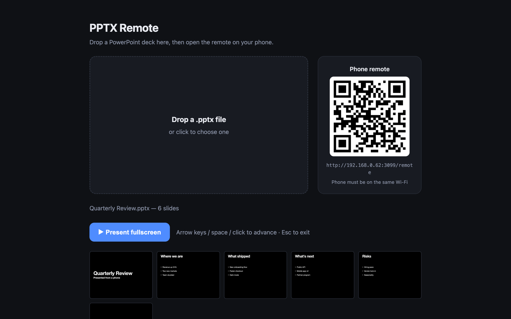

# PPTX Remote

Present a .pptx fullscreen on your Mac and control it from your phone.

**Website:** https://aidenjeong8.github.io/pptx-remote/



## Quick start

```sh
git clone https://github.com/AidenJeong8/pptx-remote.git
cd pptx-remote
npm start
```

1. On the Mac, open http://localhost:3000 and drop in a .pptx. Keynote converts it to slide images.
2. On your phone (same Wi-Fi), scan the QR code or open the remote URL that the server prints.
3. Click **Present fullscreen** on the Mac, then use Prev/Next or tap any thumbnail on the phone.

## Requirements

- macOS with Keynote (free from Apple)
- Node.js 18+. There are no npm dependencies.

The first time you convert a deck, macOS asks whether Terminal can control Keynote. Click OK.

## Notes

- Animations and transitions are not kept: each slide shows as a single image.
- Browsers only allow fullscreen after a click on that computer, so start the presentation on the Mac once.
- If a conversion hangs or fails, quit and reopen Keynote.

## How it works

`server.js` is a single file with no dependencies. On upload it runs `export.applescript`, which has
Keynote export each slide as a PNG and print the speaker notes. The server keeps track of the current
slide and pushes it to every open page (the presenter on the Mac and the remote on the phone) over
Server-Sent Events.

The landing page lives in `docs/` and is served by GitHub Pages.

## License

MIT
